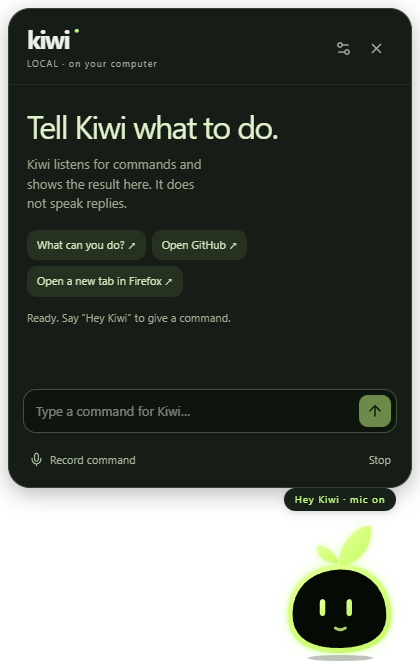

# Kiwi desktop companion

Kiwi lives in a small transparent window in the bottom-right corner of Windows. The supplied lime mascot breathes, blinks, follows your cursor with its eyes, and animates while listening and working. Click Kiwi to open the command panel; closing the panel leaves the mascot on your desktop. Its tray icon has Show, Stop, Pause microphone and Quit controls.

## Test the Windows build

Open `frontend/release/Kiwi-Portable-0.1.1.exe` directly, or install `frontend/release/Kiwi-Setup-0.1.1.exe`. Both are unsigned local test builds. Windows may show an unknown-publisher/SmartScreen prompt. These executables do not require Node, pnpm, a browser dev server or system Python.

**Where do I get the installer?** `frontend/release/` is not committed to Git. Build it in GitHub: **Actions → Release Windows installer → Run workflow** (or push a tag such as `v0.1.2`, which also creates a GitHub Release), then download the `kiwi-windows` artifact. Or build it yourself, see [Build the release yourself](#build-the-release-yourself).

On this computer Ollama and `qwen3:1.7b` are installed. Other computers need Ollama plus that model, or a personal compatible API key in Settings. Speech recognition uses a separately downloaded English model: use **Download speech model** in Settings if it is missing. Downloaded models stay outside the installer. No claim is made that model downloads work without an internet connection.

- **Say “Hey Kiwi”, pause for Kiwi to listen, then speak your request.** No button is needed. Wake listening starts automatically. The smile changes to an animated speaker, and provisional words appear below the mascot. The completed command is checked locally before it runs. “Hey Kiwi, open GitHub” in one utterance is also supported.
- Click Kiwi for the optional command/settings panel. The microphone button remains a manual fallback.
- `Ctrl+Shift+Space`: open Kiwi and toggle microphone recording.
- `Ctrl+Shift+.`: stop speech and cancel the model request. Esc also stops inside the panel.
- **Listen for “Hey Kiwi”** in Settings and **Pause microphone** in the tray disable hands-free listening. A bare wake phrase opens a 12-second command window. Windows offline speech provides live hypotheses; local Whisper checks final audio. Live words can be revised. “Kiwi stop” and the stop hotkey cancel work; ordinary wake listening pauses during responses to avoid hearing Kiwi's own voice.
- Kiwi uses speech only for input. It never speaks replies; completed actions are shown on screen.

Try “open GitHub and YouTube”, “open a new tab in Firefox”, “search for pizza recipes”, “play lo-fi”, “open calculator”, “volume down”, “pause music”, “switch to dark mode”, “set a 25 minute timer”, or “what time is it?”. Music commands open a search page; play/pause sends media keys to the active media app. Timers require Kiwi to remain running.

“Build a coffee shop landing page” drafts one standalone HTML page. Kiwi asks before generating and before writing/opening it, saves only a new folder in `Documents/KiwiProjects`, opens VS Code if installed in its standard user location, and opens the browser preview. This is a bounded page builder, not a general autonomous coding agent. It does not run generated shell commands or install packages.

API keys are encrypted with Electron safeStorage in the main process, never returned to the renderer. Cloud mode is used only for the bounded website-drafting feature; it does not send screenshots, clipboard or microphone audio. Kiwi does not expose arbitrary shell execution, passwords, file deletion, or unrestricted computer control. New desktop capabilities should be added as explicit, validated actions in `frontend/electron/actions.cjs`.



## Complete Windows installation guide

### Option A: portable build (recommended for a first test)

1. Open `frontend/release/Kiwi-Portable-0.1.1.exe`.
2. If Windows SmartScreen appears, choose **More info → Run anyway**. This local hackathon build is unsigned; the warning is about publisher verification, not a Kiwi runtime failure.
3. Keep the portable executable in a permanent folder. Do not launch it directly from a temporary archive folder.
4. Kiwi appears above the Windows taskbar in the bottom-right. It does not create a normal taskbar button.
5. Click the mascot once to open the command panel. Click the `X` in the panel to return to the small always-on-top mascot.

The portable build is self-contained. It does not need Node.js, pnpm, Python, a browser dev server, or the repository after it has been built. It does need a working Windows microphone for hands-free commands and Firefox if you ask specifically for a Firefox tab.

### Option B: installer

1. Run `frontend/release/Kiwi-Setup-0.1.1.exe`.
2. Choose an install location and finish the wizard.
3. Start **Kiwi** from the Start menu.
4. To remove it, use Windows **Installed apps**. The portable executable can simply be closed and deleted.

Both files are unsigned release artifacts for local testing. The installer and portable build contain the same Electron application; the installer only adds the normal Windows install/uninstall wrapper.

### First-run checklist

1. Make sure the microphone is connected and selected in **Windows Settings → Privacy & security → Microphone**. Allow desktop apps to access it.
2. Start Kiwi and wait for the status chip to say **Hey Kiwi · mic on**.
3. Say **Hey Kiwi**, pause for the mascot to change its smile to the animated speaker, and then say a command. No button press is required.
4. The live words appear below Kiwi. They are provisional until the local decoder verifies the finished phrase.
5. Kiwi performs the command and leaves a text confirmation in the panel. Kiwi intentionally does not speak replies.
6. If you do not want the microphone active, turn off **Listen for “Hey Kiwi”** in Settings or choose **Pause microphone** from the tray menu.

The first voice run may need the English speech model. Open the panel, choose Settings, and press **Download speech model**. The download is stored outside the installer and is reused on later launches. The current packaged listener uses Windows offline speech for the wake phrase and a local Whisper decoder to verify the completed command; no microphone audio is sent to a cloud service by default.

### Commands that work in the current build

| Say this | What Kiwi does |
| --- | --- |
| `open GitHub` | Opens the known GitHub HTTPS site. |
| `open GitHub and YouTube` | Opens both known sites. |
| `open Discord`, `open Spotify`, `open Steam` | Opens the installed desktop app. If it is not installed, opens its website and says so. |
| `open Discord in the browser` | Opens the website even when the app is installed. |
| `find my screenshots`, `find my tax return` | Lists matching files from Desktop, Documents, Downloads, Pictures, Videos and Music (read-only, newest first). `open the first one` opens a result, but only documents, images and media. |
| `open downloads`, `open screenshots` | Opens that folder in Explorer. |
| `close Chrome`, `quit Discord` | Asks that app to close, after a confirmation dialog. Only a short named list; never a force-kill. |
| `open the weather`, `weather in Copenhagen` | Opens the Windows Weather app, or a web search for the place. |
| `write a message to Hizashi saying hello` | Opens Discord and copies the text to the clipboard. You open the chat, paste and press Enter. Kiwi never types into other apps or sends messages. |
| `open Chrome`, `open Edge`, `open Opera`, `open Settings`, `open Task Manager`, `open Paint` | Launches that app from its usual install location, or reports that it is not installed. |
| `open a new tab in Firefox` | Launches Firefox with a blank new tab. |
| `open a new Firefox tab to GitHub` | Opens GitHub in a new Firefox tab. |
| `open calculator`, `open notepad`, `open Firefox` | Launches the allow-listed Windows application. |
| `search for pizza recipes` | Opens a Google search in the default browser. |
| `play lo-fi` | Opens a YouTube Music search. |
| `volume up`, `volume down`, `mute`, `pause music`, `next track` | Sends the corresponding Windows media key. |
| `switch to dark mode` | Changes the Windows light/dark preference. |
| `set a 5 minute timer` | Creates a local Windows notification timer. Kiwi must remain running. |
| `what time is it` | Shows the local computer time. |
| `build a coffee shop landing page` | Runs the bounded website draft flow, with approval before writing/opening files. |
| `Kiwi stop` | Cancels the active command or model request. |

Commands are parsed in the Electron main process. Direct commands do not require the cloud provider or a conversational model. Ollama is only needed for the optional website drafting flow and for any future model-backed tools you explicitly enable.

### How PC access works

Kiwi is a desktop app, so the privileged part lives in Electron’s main process rather than in a browser tab. The renderer can request only named IPC operations. The action router then validates the request and calls one of a small number of explicit actions: open a known application, open a validated HTTPS URL, launch a Firefox tab, send a media key, set the Windows theme, or create a timer.

This is deliberate. Giving a language model unrestricted PowerShell, filesystem access, password typing, or arbitrary window-control rights would let a transcription error or malicious page delete data or leak secrets. Kiwi therefore does **not** claim to do literally anything on the computer. To add a new capability, implement a narrow action in `frontend/electron/actions.cjs`, add an intent test, validate all inputs, and return a real success or error result. Never execute raw speech as a shell command.

### Troubleshooting

**“Kiwi could not start.”** Close every old Kiwi window from the tray or Task Manager, then launch the newest executable from `frontend/release`. If it still fails, inspect `%APPDATA%\Kiwi\logs\startup.log`. Rebuilding from source also clears stale renderer files: run `pnpm.cmd build` inside `frontend`, then launch with `pnpm.cmd desktop`.

**The mascot is visible but does not hear me.** Check microphone privacy permissions, confirm that the Windows speech language includes English, and make sure Kiwi is not paused in the tray. The small status chip should say **Hey Kiwi · mic on**. Use `Ctrl+Shift+.` to stop a stuck command, then re-enable the microphone.

**Kiwi hears “Hey Kiwi” and shows words, but the command never runs (running from source).** Hands-free uses two helpers that are not committed to Git. Build the Windows listener with `pnpm build:listener` inside `frontend`. Set up the speech service with `python scripts/dev.py setup`, then choose **Download speech model** in Settings (about 480 MB, once). Without the speech service Kiwi reports “Speech service is not set up”. The installer from the workflow above bundles the service; it still needs the one-time model download.

**The mic works but is unreliable.** First make sure the speech model is downloaded (Settings, **Download speech model**); without it every spoken command fails with “Speech model is not ready”. To see which stage fails, start Kiwi with `KIWI_VOICE_DEBUG=1` (in Git Bash: `KIWI_VOICE_DEBUG=1 frontend/release/Kiwi-Portable-0.1.1.exe`). Each attempt is then written to `%APPDATA%Kiwilogsoice-debug.jsonl` with the recognizer’s text and confidence, what Whisper heard, and whether the command was accepted. The log holds text only, never audio, and nothing is written unless the variable is set.

**The words are wrong.** Speak the wake phrase first, pause briefly for the speaker animation, and use short direct commands. Kiwi shows provisional words because Windows speech can revise them. A final command is rejected if its verified audio no longer contains the addressed wake phrase.

**Firefox does not open.** Install Firefox in its normal `Program Files` location or add `firefox.exe` to PATH. Kiwi checks the standard 64-bit, 32-bit, and per-user locations and otherwise asks Windows to resolve `firefox.exe`.

**Ollama or the model is unavailable.** Direct desktop commands still work. For the optional website builder, install Ollama, run `ollama pull qwen3:1.7b`, or add your own compatible provider key in Settings. Do not configure a model larger than the documented local budget without reviewing the machine-performance impact.

**Windows shows an unknown-publisher warning.** This release is unsigned. Verify that the file came from this repository/build, then accept the local test warning or build a signed release with your own certificate.

### Build the release yourself

From PowerShell at the repository root:

```powershell
cd frontend
pnpm.cmd install --frozen-lockfile
pnpm.cmd test
pnpm.cmd test:desktop
pnpm.cmd lint
pnpm.cmd build
pnpm.cmd dist
```

`pnpm.cmd dist` builds the React renderer, compiles the Windows speech listener, bundles the local Whisper helper, and creates both `frontend/release/Kiwi-Setup-0.1.1.exe` and `frontend/release/Kiwi-Portable-0.1.1.exe`. Build output is ignored by Git. If an old Kiwi instance is running, quit it before rebuilding or Windows may keep the old packaged process alive.

### Repository layout after the branch merge

The working Windows release is the `frontend/` Electron app described above. The merged `kiwi/` directory is the separate development architecture brought over from `origin/development`; it is intentionally retained for continued work and is not yet the entry point for the tested `frontend/release` binaries. Do not mix its install commands with the release commands above.

## Build and verify from source

```powershell
python scripts/dev.py setup
backend/.venv/Scripts/python.exe -m pip install -r backend/requirements-build.txt
cd frontend
pnpm.cmd install --frozen-lockfile
pnpm.cmd build
pnpm.cmd test
pnpm.cmd test:desktop
pnpm.cmd lint
pnpm.cmd desktop
# Quit Kiwi before rebuilding its packaged files:
pnpm.cmd dist
```

`pnpm dist` builds the renderer, freezes the speech service, and creates the Windows NSIS and portable executables. Icon sources are in `frontend/build`; `pnpm build:icons` regenerates them from the provided SVG using a hidden Electron window. Release binaries and model files are intentionally not committed. See `docs/QA_CHECKLIST.md` and `docs/DEMO.md` for actual checks and the demo sequence.

## DockProof development workspace

[](https://github.com/Hizashii/Hackathon/actions/workflows/ci.yml)

AI-powered delivery reconciliation. DockProof compares a purchase order, delivery note and invoice,
uses a small local open-weight model (Qwen3 1.7B via Ollama) to match differently named products,
and uses deterministic code for quantities, prices, discrepancies and claims. Claims require human approval.

> This original document workflow is retained for development and is not included in the standalone companion installer. Its state is process-local and clears on backend restart. See `docs/MAP.md`.
> See `AGENTS.md`, `CLAUDE.md` and `DESCRIPTION.md` for scope and rules.

## Stack

- Frontend: React + TypeScript + Vite + Tailwind CSS v4, pnpm, native `fetch`
- Backend: Python 3.11+ / FastAPI / Pydantic / process-local memory
- Scan reading: RapidOCR (ONNX, installed via pip) for photos/screenshots; PyMuPDF for text PDFs
- AI: `qwen3:1.7b` (Apache 2.0) through Ollama, called with `httpx`

## Structure

```text
frontend/   React app (src/{components,pages,hooks,services,types,lib})
backend/    FastAPI app (app/{api,services,models,schemas,core}, tests/)
fixtures/   Synthetic sample documents
```

## Prerequisites

Works on **Windows 10/11, Linux and macOS**. You need Node 20+ with pnpm (`npm install -g pnpm`), Python 3.11+ (Linux: `sudo apt install python3-venv`), and [Ollama](https://ollama.com/download). A recent Chrome, Edge or Firefox is recommended.

## Quick start (any OS)

```bash
python scripts/dev.py setup     # creates backend/.venv, installs backend + frontend dependencies, copies .env
python scripts/dev.py doctor    # shows what is installed (pnpm, Ollama, models, cloudflared)
python scripts/dev.py           # runs backend (8000) and frontend (5173); Ctrl+C stops both
```

For the companion desktop app, use Electron from `frontend/`:

```bash
cd frontend
pnpm desktop:dev   # build then launch the desktop companion
pnpm build
pnpm desktop       # launch the companion from built local files
```

The companion loads local files and uses narrow Electron IPC. The speech sidecar starts only when needed, on a random loopback port with a per-launch token. Development mode uses the Python venv for that sidecar; the packaged build contains its own runtime. The separate document workspace still uses `python scripts/dev.py` and FastAPI on port 8000.

On Windows run the same commands from PowerShell or cmd (`py scripts/dev.py setup` works too). Add `--lan` to reach the app from a phone on the same Wi-Fi. On Linux/macOS `make backend` / `make frontend` still work; on Windows use the script instead (the Makefile uses `.venv/bin`).

<details><summary>Manual setup</summary>

```bash
# Backend: Linux/macOS                                # Windows PowerShell
cd backend                                            # cd backend
python3 -m venv .venv && source .venv/bin/activate    # py -m venv .venv ; .venv\Scripts\Activate.ps1
python -m pip install -r requirements.txt             # python -m pip install -r requirements.txt
cp .env.example .env                                  # copy .env.example .env
python -m uvicorn app.main:app --port 8000

# Frontend
cd frontend && pnpm install && pnpm dev
```
</details>

**Public tunnel for the deployed frontend** (optional): install `cloudflared` (Windows: `winget install Cloudflare.cloudflared`; macOS: `brew install cloudflared`; Linux: download from Cloudflare's releases), then `cloudflared tunnel --url http://localhost:8000`.

## Ollama

Install Ollama from <https://ollama.com/download>, then:

```bash
ollama pull qwen3:1.7b                        # ~1.4 GB: matching and recovery
ollama run qwen3:1.7b    # optional interactive smoke test
```

The backend never downloads the model or runs inference at startup. If Ollama is unavailable, uncertain matches remain for human review.

## Development commands

| Task | Command |
|---|---|
| Backend tests | `cd backend && pytest` |
| Model accuracy check (needs Ollama) | `cd backend && PYTHONPATH=. python scripts/eval_matching.py` |
| OCR spike on an image | `cd backend && python scripts/ocr_spike.py IMAGE` |
| Frontend build + typecheck | `cd frontend && pnpm build` |
| Frontend lint | `cd frontend && pnpm lint` |

See `docs/DEPLOY.md` for phone access and the Vercel + tunnel deployment, and `docs/CI-CD.md` for the GitHub Actions pipeline.

## Live dock demo

Open <http://localhost:5173> on the laptop. The office screen shows a QR link for a phone on the same Wi-Fi or hotspot. Scan it to open `/dock` on the phone. Use **Chaos Dock** to generate synthetic purchase orders and delivery notes, or upload scans directly. The watcher reads generated pairs from `dock-inbox/` through the same OCR pipeline. Review a shortage, open its proof, and approve the draft claim only after checking it. **Reveal answer key** compares the result with the synthetic key after processing.

For **AutoRecover**, expand a shortage on the office result, click **Find Recovery Options**, then create a draft replacement order. Approval records a local decision; nothing is sent to a supplier.

State lives in the backend process and is cleared when it restarts. The frontend stores the session ID in localStorage so refreshes reconnect while the backend stays running.

Suppliers are loaded from `fixtures/suppliers.json` into memory at backend startup. The seed is idempotent within a running process; to re-seed manually run `cd backend && PYTHONPATH=. python -c "from app.services.suppliers import seed_suppliers; print(seed_suppliers())"`.
New endpoints: `GET /api/suppliers`, `POST /api/reconciliations/{id}/discrepancies/{item}/recover`, `GET .../recovery`, `POST /api/recovery-plans/{id}/draft-order`, `POST /api/replacement-orders/{id}/approve|reject`, `POST /api/demo/missing-tomatoes`.

## Ask by voice (the agent)

Kiwi is also available as a lightweight desktop-style dock in the bottom-right corner. Open its dashboard to switch between local Ollama and a personal OpenAI-compatible key. The key is kept in the current browser session and sent only with assistant requests; it is not saved in `.env`, SQLite, or the prompt context. Use the local Ollama option for the no-cost, offline-friendly path. ChatGPT and API billing are separate, although some eligible Pro/Business plans may include API credits.

**Hey agent, anywhere on the site.** Saying "Hey agent" (alone, or followed by your request) opens the agent already listening, so no click is needed. It keeps listening until you have been silent for 3 seconds. The **Hey agent** switch in the header turns this off (remembered per browser). Audio that does not start with the wake phrase is discarded and never reaches a model; transcription runs on your machine.

- **Open my files**: the agent shows a paperclip. Tap it and pick your purchase order and delivery note from wherever you keep them. Reading starts the moment they are in. (Browsers do not allow a page to open a file dialog from speech alone, so one tap is needed.) Names containing "order"/"po" or "delivery"/"dn" are sorted automatically; otherwise the agent asks which is which.
- **Walkthrough**: after a delivery is analysed the agent docks to the bottom and tours the result by voice: the headline, the two columns read from your scans, why the red rows are red, the open product question, the draft claim, the recovery option and the notes. It outlines each thing on the page and highlights the keywords it mentions. Say "walk me through it" to hear it again; the skip button stops it.
- **Models**: speech is transcribed by open-weight Whisper (`small.en` via faster-whisper, about 480 MB, preloaded when the backend starts; set `WHISPER_MODEL`/`WHISPER_LANGUAGE` in `backend/.env`). A local Qwen3 1.7B model (`ASSISTANT_MODEL`, falls back to `OLLAMA_MODEL`) answers free questions from the text DockProof read, keeping one small model loaded for a responsive laptop demo. Any number in an answer that is not in the data is rejected and replaced by the stored results. Kiwi's dashboard also accepts a user's own OpenAI-compatible API key for a cloud model; ChatGPT subscriptions do not provide free API credits, so Ollama is the no-cost path.

**If "Hey agent" does not react**
- The header switch shows the real state. *Click the page once*: browsers keep audio suspended until you click or press a key. *Mic blocked*: allow the microphone in the address bar. *Needs HTTPS*: use `localhost` or an https address (a plain `http://192.168...` address has no microphone).
- It shows what it heard when that was not the wake phrase (for example "Heard: hey asian"), so you can tell a misheard phrase from a dead microphone.
- The first voice request needs the Whisper model; check the backend log if it is still downloading.
- Spoken answers use the browser's built-in voice. Some Linux setups have none installed (Chrome then stays silent; on Debian/Ubuntu try `sudo apt install speech-dispatcher espeak-ng`). The agent keeps working without a voice; the text is shown.

- **Memory and speed**: the conversation is saved per session in the browser (it survives a reload) and the last 8 turns are sent to the model so follow-ups like "and how long does it take?" work. Answers stream sentence by sentence and are spoken as they arrive; each sentence is number-checked before it is shown. The header status says *Waiting*, *Listening to you*, *Thinking* or *Speaking (not listening)*, and shows what was heard.

Endpoints: `POST /api/voice/transcribe`, `POST /api/reconciliations/{id}/ask`, `POST /api/reconciliations/{id}/ask/stream`, `GET /api/reconciliations/{id}/cards`.

## URLs

- Frontend: <http://localhost:5173>
- API: <http://localhost:8000> (health: `/api/health`, docs: `/docs`)

## Environment variables

| File | Variable | Default |
|---|---|---|
| `backend/.env` | `OLLAMA_BASE_URL` | `http://localhost:11434` |
| `backend/.env` | `OLLAMA_MODEL` | `qwen3:1.7b` |
| `backend/.env` | `CORS_ORIGINS` | `http://localhost:5173` |
| `backend/.env` | `CORS_ORIGIN_REGEX` | private-LAN dev origins |
| `frontend/.env` | `VITE_API_URL` | unset = same host as the page, port 8000 |
